# halloween.supply: OpenCV 5 perception for an agent that shops a screenshot

halloween.supply turns a photo of a costume into a cart of real products from independent merchants. For this entry we replaced the language-model vision calls in that flow with an OpenCV 5 service on AWS Graviton (built with COOL), and wrapped it in an agent loop where OpenCV's match measurements decide whether to accept a product, search again with a corrected query, or ask the shopper. Every step emits a trace the shopper can see.

- Live: https://halloween.supply/screenshot
- Diagrams: [architecture](architecture.svg), [agent loop](agent-workflow.svg)
- Reproduce: [reproduce.md](reproduce.md) · Responsible use: [responsible-use.md](responsible-use.md)
- Featured paths claimed: **Agentic Vision** (section 7) and **Best Use of COOL** (section 6)

## 1. Problem

Costume ideas arrive as pictures: a film still, a friend's party photo, a Pinterest pin. Buying one means working out which garments make up the look, what each is called in a shop, which colors matter, and then checking dozens of product photos to see whether they are the same thing. A person does that by eye. Our previous version did it with two calls to a multimodal language model, one to list the garments and one to judge the product photos (`decomposeScreenshot` and `reviewScreenshotProducts` in `lib/sourcing/screenshot-vision.ts` on `main`). That worked, but it produced judgments without measurements: when it accepted a red hat for a brown one we could not see why, and the system had nothing to act on except a yes or no.

The problem we set out to solve is to make perception measurable, so that the agent can read what was wrong with a candidate (wrong color, wrong garment type, no garment in the photo) and change its next search because of it.

## 2. Users

The shopper is an adult buying a Halloween costume, usually on a phone, a few days before an event. They want something that looks like the picture and arrives in time; they do not want to learn garment vocabulary or open thirty merchant tabs. They need to trust the result, which is why the system shows its evidence and asks before using a weak match.

The second user is the store operator, who fulfils orders manually across merchants. For them the trace is an audit log: it shows which query found each product and how well it scored.

## 3. Architecture

The shopper uploads a screenshot to `/api/screenshot-costume` on Vercel. The route re-encodes it (EXIF stripped, at most 1024 px), sends the bytes to the vision service through CloudFront, and gets back the person's garments. For each garment it searches merchants (Firecrawl web and image search), fetches the product photos, and sends those bytes to the vision service to be scored. The agent loop decides what to do with the scores, and the route streams NDJSON events back to the browser as it goes, so matches appear before the whole request finishes. The request has a 30 s budget (`SEARCH_BUDGET_MS`), unchanged from the previous version.

The interface between the two halves is a small JSON contract with two endpoints, `/v1/analyze` and `/v1/match`, plus `/healthz`. The service never fetches URLs, so it cannot be turned against internal addresses, and every response carries an `X-OpenCV-Build` header naming the OpenCV version and build. TODO(verify): contract as implemented in `vision/app/` and `lib/sourcing/vision-client.ts`.

Mode is a single environment variable: `SCREENSHOT_VISION=opencv` (default) or `luna` (the old path, kept for the comparison in section 8). With `opencv` selected and no service URL configured, the route returns 503 instead of falling back silently. TODO(verify): `app/api/screenshot-costume/route.ts` on `oh-cv-agent`.

## 4. OpenCV 5 implementation

All image analysis in the service runs through OpenCV 5. Neural networks are loaded with `cv2.dnn` from ONNX files; there is no PyTorch, onnxruntime or transformers at runtime. TODO(verify): `vision/pyproject.toml` and `uv.lock` on `oh-cv-service`.

**Analyze** (`POST /v1/analyze`) runs this pipeline on one screenshot:

1. **Segment.** A SegFormer-B2 clothes-parsing model (`mattmdjaga/segformer_b2_clothes`, 18 labels) runs in `cv2.dnn` and labels every pixel as background, a body part or a garment class. TODO(verify): model file, engine flag and input size.
2. **Merge regions.** Garment labels become pieces ordered head to toe; left and right shoes merge into one piece; regions under 0.5% of the image are dropped.
3. **Measure color.** Each mask is eroded slightly, then k-means (k=3) runs on its pixels in Lab space (`cv2.kmeans`). The dominant cluster is named with the nearest of about 30 retail color names. A piece is `patterned` when a second cluster is large and far in ΔE, or when Canny edge density inside the mask is high. TODO(verify): `vision/app/colors.py`.
4. **Embed and classify.** The crop goes through the CLIP ViT-B/32 image encoder in `cv2.dnn` to a 512-d normalized vector, which is compared by cosine similarity against precomputed text embeddings of a garment vocabulary, restricted to phrases for the same region. TODO(verify): vocabulary size in `vision/vocabulary.json`.
5. **Write the query.** The search query is the dominant color plus the best garment phrase, for example "brown felt cowboy hat", with an alternate phrasing for a second search. DIY items carry an assembly note (for example, a bedsheet ghost).

**Match** (`POST /v1/match`) scores up to 12 product photos against one piece. It finds the garment in each photo with the segmenter when a person is wearing it, or with GrabCut seeded from a white-background threshold for ordinary product shots. It then computes three measurements: CLIP embedding similarity to the screenshot crop, CIEDE2000 distance between dominant Lab colors, and `cv2.compareHist` correlation on masked hue-saturation histograms. A weighted score maps to a verdict (`match`, `weak`, `reject`) with a list of reasons (`color_mismatch`, `type_mismatch`, `no_garment`, `low_quality`). The reasons are what the agent loop reads. TODO(verify): weights and thresholds in `vision/app/scoring.py`.

| OpenCV 5 function | Used for |
|---|---|
| TODO(verify) `cv2.dnn.readNet`, `blobFromImage`, `forward` | SegFormer segmentation, CLIP embeddings |
| TODO(verify) `cv2.kmeans`, `cvtColor` (Lab, HSV) | Dominant colors |
| TODO(verify) `cv2.erode`, `connectedComponentsWithStats` | Mask cleanup, region merging |
| TODO(verify) `cv2.Canny` | Pattern detection |
| TODO(verify) `cv2.grabCut`, `threshold` | Product-photo foreground |
| TODO(verify) `cv2.calcHist`, `compareHist` | Color histogram similarity |

## 5. AWS deployment

TODO(verify): every item below against `infra/` on `oh-cv-aws`.

The service runs as one container on an EC2 Graviton instance in `us-east-1`. CloudFront terminates HTTPS in front of it with caching disabled, and the instance's security group accepts traffic only from CloudFront's managed prefix list. The container image lives in ECR (`halloween-vision`); the shared bearer token lives in SSM Parameter Store as a SecureString and is read at boot through the instance role. Logs go to CloudWatch through the awslogs driver (`/halloween/vision`), and a metric filter on the service's JSON log lines feeds a dashboard with request count, p50/p95 latency and CPU. The instance requires IMDSv2, has an encrypted EBS volume and no SSH key; operators use SSM Session Manager.

Everything is created by idempotent AWS CLI scripts in `infra/`, run in numbered order, and removed by `infra/99-teardown.sh`. See [`infra/README.md`](../../infra/README.md).

TODO(numbers): instance type and hourly cost.

## 6. COOL

TODO(verify): COOL listing, delivery option and how `cv2` is provided, from `vision/Dockerfile.cool` and `infra/README.md`.

The service code does not care which `cv2` it imports. The stock image pins `opencv-python-headless==5.0.0.93`; the COOL image replaces it with COOL's OpenCV build for Graviton. `/healthz` and every response header report `build: "cool"` or `"stock"`, detected from `cv2.getBuildInformation()`, so a judge can confirm which build served a request.

The benchmark (`vision/bench/`) imports the same service modules in-process and runs a fixed workload: the 25 catalog images through analyze, plus 25 match calls with 6 candidate photos each, with 3 warm-up and 10 measured runs. It also times the individual OpenCV operations the service uses. It ran in three configurations: COOL on Graviton, stock `opencv-python-headless==5.0.0.93` on the same Graviton instance type, and stock on x86 (`c7i.xlarge`). Each result file records `cv2.getBuildInformation()` as evidence of which build ran.

| Configuration | Instance | analyze p50 | analyze p95 | match p50 | images/s | $ per 1,000 images |
|---|---|---|---|---|---|---|
| COOL, Graviton | TODO(numbers) | | | | | |
| Stock, Graviton | TODO(numbers) | | | | | |
| Stock, x86 | c7i.xlarge | TODO(numbers) | | | | |

Source: [`vision/bench/out/cool.md`](../../vision/bench/out/cool.md). TODO(numbers).

## 7. Agent workflow

The loop runs once per garment, in parallel, inside the 30 s request budget:

1. **Perceive.** `/v1/analyze` returns the pieces. If no person is found, or the person confidence is below 0.5, the agent stops before searching and asks the shopper to crop to one person.
2. **Act.** Search merchants with the piece's query.
3. **Re-perceive.** Send the candidates' product photos to `/v1/match`.
4. **Decide.** One table-driven function, `decideNext(piece, results, attempt)`, picks the next action from the verdicts and reasons:

| Observation | Next action |
|---|---|
| Best verdict is `match` | Accept the product |
| `color_mismatch` dominates | Search again with the measured color name forced to the front (second color as fallback) |
| `type_mismatch` dominates | Search again with the next garment phrase from `garment_types` |
| No candidates, or `no_garment` | Search again with the alternate query |
| 2 retries used, or under 6 s of budget left | Keep the best `weak` product and mark it `needs_approval` |

TODO(verify): table as implemented in `lib/sourcing/` on `oh-cv-agent`.

This is what makes it agentic in the sense the award describes: the visual measurement changes the next action. A `color_mismatch` on a hat produces a different query than a `type_mismatch` on the same hat, and both are different from asking the shopper.

**Trace.** Each step appends `{ t_ms, piece, step, detail }`, where `step` is `perceive`, `search`, `score`, `decide` or `approve`. The route streams it to the browser as a `trace` event, where the "How we matched this" panel shows the crop, measured colors, scores and retries, and logs it as one JSON line per request. TODO(verify): event and panel on `oh-cv-agent`. A recorded trace with a retry that found a better match is in TODO(verify) `eval/traces/`.

## 8. Evaluation

TODO(numbers): all of this section from `eval/out/` on `oh-cv-eval`.

**Data.** The 25 catalog costumes, each with an editorial image (`public/costumes/*.png`) and a ground-truth list of purchasable components with slot, garment phrase and main color (`eval/ground-truth.json`), drafted from the catalog and spot-checked by hand.

**Decomposition** (`scripts/eval-decompose.ts`). Each editorial image goes through `/v1/analyze` and, as a baseline, through the previous `gpt-6-luna` decomposition. Predicted pieces are matched to ground truth by slot and garment-phrase similarity.

| Metric | OpenCV 5 | gpt-6-luna |
|---|---|---|
| Precision | TODO(numbers) | |
| Recall | TODO(numbers) | |
| Slot accuracy | TODO(numbers) | |
| Color-name accuracy | TODO(numbers) | |
| Latency per image (p50) | TODO(numbers) | |
| Cost per image | TODO(numbers) | |

Source: [`eval/out/decompose.md`](../../eval/out/decompose.md).

**Agent loop** (`scripts/eval-agent.ts`). The full route in `opencv` mode on all 25 images.

| Outcome | Pieces |
|---|---|
| Matched on the first search | TODO(numbers) |
| Recovered by a retry | TODO(numbers) |
| Left as `needs_approval` | TODO(numbers) |
| Unmatched | TODO(numbers) |
| Time to first match (p50) | TODO(numbers) |
| Time to completion (p50) | TODO(numbers) |
| Human-labelled acceptable matches | TODO(numbers) |

Source: [`eval/out/agent.md`](../../eval/out/agent.md).

## 9. Limitations and failure cases

TODO(numbers): named failure cases with images from `eval/out/`.

- The evaluation images are generated editorial images, not real screenshots, and there are only 25. The ground truth was drafted by us from our own catalog, and garment-phrase matching uses a small synonym table, so it is approximate.
- The garment vocabulary is fixed. A garment that isn't in it gets the nearest phrase, which can produce a reasonable color with the wrong noun.
- Clothes parsing labels 18 classes. Costume-specific items (capes, wings, masks, props) have no label of their own, so they fall into the nearest class or are missed. TODO(verify) against the failure cases.
- Merchant search coverage and inventory, not perception, limit many results: a perfect query can still return no good product within 30 s.

## 10. Responsible use

The system reads clothing only. It loads no face or identity model, titles a look by its garments, does not store or log images, strips EXIF before analysis, and never buys anything without the shopper; weak matches need explicit approval. The full list, with the code or configuration that enforces each point, is in [responsible-use.md](responsible-use.md).
