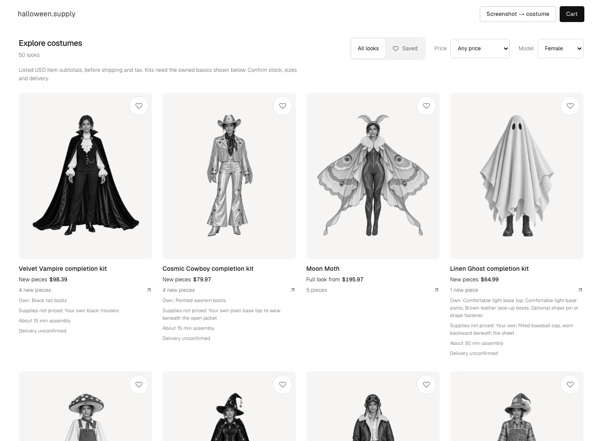
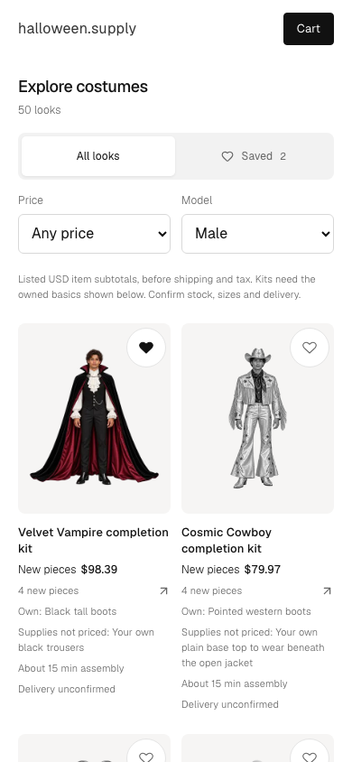

# Price-aware costume discovery

The existing gallery showed piece counts without purchase subtotals. Shoppers could not compare affordable completion kits against full outfits.

The gallery now shows one explicit purchase basis per card. Eligible completion kits show their fixed new-piece subtotal and named owned basics. Other costumes show the lowest listed subtotal for every catalog piece, including optional pieces. Known unavailable options do not lower those starting prices.

The price selector uses the subtotal shown on each card. Its inclusive limits are $50, $100, and $200. The default view still contains all 50 costumes. Price combines with search, Saved, and model controls. A specific empty-price state lets shoppers clear the price filter without clearing their search.

Kit cards retain the kit name, including the Queen of Hearts dress limit of 18w–20w. They name extra supplies as unpriced, show estimated assembly time, and state that delivery is unconfirmed. Pickup evidence names its exact item count. It does not imply pickup for the whole kit or confirmed delivery.

Cards open `/costumes/<costumeSlug>?kit=<kitSlug>`. The separate look UI lane owns applying those selected, owned, and skipped choices. This lane does not change the 50 original catalog records or image assets.

## Design choice

Two approaches were compared: a separate affordable-kit shelf, or prices and filtering in the existing gallery. A separate shelf gives kits more space but duplicates costumes and splits search and Saved behavior. The existing gallery keeps one browsing model, so it was chosen. Concise owned-piece labels keep phone cards readable; detailed notes remain on the kit page.

## Runtime evidence

The real local app ran with Next.js 16.4.3 and Turbopack. It used the final ten-kit aggregate `eb8a876` and bundled catalog. No provider keys were loaded.

`bun scripts/verify-discovery-kits.ts http://127.0.0.1:3411 --require-kits` passed:

- All 50 original cards remain visible by default, with exact listed purchase subtotals.
- All ten kits preserve their kit links, owned basics, supplies, names, and delivery limits.
- The $50, $100, and $200 limits return 4, 11, and 35 looks respectively.
- Price, Saved, and model controls compose without losing saved looks.
- Exact-name search, empty-price recovery, and Escape-to-clear work.
- The 390px and 320px layouts have no horizontal overflow.
- Price and model controls remain in keyboard tab order.
- No browser exceptions occur.

Focused ESLint, `bunx tsc --noEmit --pretty false`, and `git diff --check` also passed. The full build remains the coordinator's check.

The built-in browser was unavailable. Aside's direct local browser confirmed the native price control and its four-result $100 fallback state before kit data arrived. The automated check then verified all ten real kit records in Chromium.

## Limits

These checks use a desktop browser at phone viewport widths. They do not establish physical-device behavior or production deployment. They confirm discovery links, rather than kit application or cart contents on the destination page. Search used its local fallback; semantic-provider behavior was not retested. Telemetry calls use the shared best-effort helper; collector persistence is verified by the measurement lane.

Merchant stock, sizes, delivery, tax, shipping, and unpriced extra supplies remain explicit shopping conditions. No event date is assumed. No new Next.js feedback candidate remained after this lane's reporting pass.
