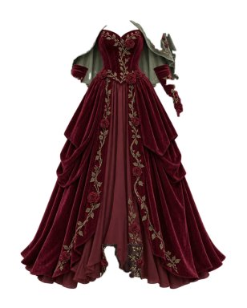
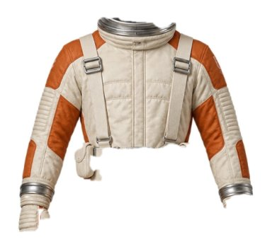
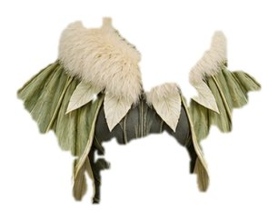

# Named failure cases (OpenCV decomposition)

These come from `decompose-opencv.json` (the run in `decompose.md`). Each case names what went wrong, the likely mechanism, and the fix it points to. Crops are the service's own `crop_b64` output. We looked at the crops marked "seen" ourselves; the others are inferred from the predicted phrases and colors.

## 1. rose-garden-queen: burgundy velvet reads as "chocolate" (seen)

The gown is plainly deep red velvet, but the service named it "chocolate", and the boots too. Velvet has deep shadows in every fold, so the largest k-means cluster is a dark red with low lightness, and the nearest `COLOR_TABLE` entry by CIEDE2000 is chocolate (`#3f2a1d`) because burgundy (`#6d1a2a`) is much lighter. The same shift explains enchanted-jester (purple read as chocolate and burgundy) and clockwork-aviator. A fix is to add darker anchors (maroon, plum, wine) to the table, or to name the color from the cluster's chroma and hue with lightness weighted down. Color accuracy on rose-garden-queen was 0/3.

## 2. retro-astronaut: off-white and silver read as beige and black (seen)

The jumpsuit is cream canvas with orange panels, the ground truth says white, and the service says beige. This one is half ground-truth ambiguity, because the fabric really is warm off-white. The helmet is the real miss: polished silver reflects a dark environment, so its dominant cluster is near black. Metallic surfaces need a specular check (high local contrast with low chroma) before naming a color. Color accuracy was 0/4.

## 3. moon-moth: collar and wings merge into one piece (seen)

The segmenter has no class for a fur collar or wings, so both fall into `upper_clothes` and come out as one "feather shoulder cape". The white fur dominates the palette, so the green wings are lost (beige instead of green), and the green unitard under them is never reported. The antennae headband is too small for a `hat` region. Recall was 1/4, the worst costume in the set. Region splitting by color (connected components per palette cluster) would recover the wings and unitard as separate pieces.

## 4. clockwork-aviator: small accessories and layered tops vanish

The service found the jacket, trousers and boots, and missed the leather aviator cap, the white shirt under the jacket, and the belt. The cap sits tight on the head, so the segmenter most likely labels it hair. The shirt shows only at the collar, so its region probably falls under the 0.5% area floor. The belt is likely absorbed into `upper_clothes` or `pants`. Recall was 3/6. The same pattern drives velvet-ringmaster (top hat, shirt and waistcoat missed, 3/6) and raven-scholar (headpiece, capelet and blouse missed, 3/6). This one pattern accounts for most of the 28-point recall gap to luna.

## 5. cosmic-cowboy: trousers become a jumpsuit

The silver jacket and silver flared trousers are the same material, so the CLIP crop of the upper body reads as "flared disco jumpsuit", and the trousers come out as a second bottom ("satin pantaloons") that does not match the ground truth. When two adjacent pieces share a dominant color within ΔE 8, the classifier should be steered away from one-piece phrases, or the vocabulary should drop one-piece garments when a separate `pants` region exists.

## 6. enchanted-jester: plum read as burgundy, both pipelines miss

Both OpenCV and luna scored 1/5 on color here. The costume is plum, which sits between purple and burgundy, and neither the retail color table nor luna's vocabulary picks purple. We kept this in the set unchanged because it is an honest ground-truth ambiguity, and it shows the color metric's floor on dark, saturated fabric.

## 7. autumn-scarecrow: wrong garment phrase and extra pieces

The plaid shirt was classified as "beekeeper jacket" and a straw-colored neck patch as "pirate head bandana" and "burlap sack". Precision was 4/6. The vocabulary has many Halloween-specific phrases, so a plain shirt with a costume-y texture pulls toward the nearest costume phrase. A generic fallback ("plaid shirt") when the top score is low would fix the query the agent searches for.
